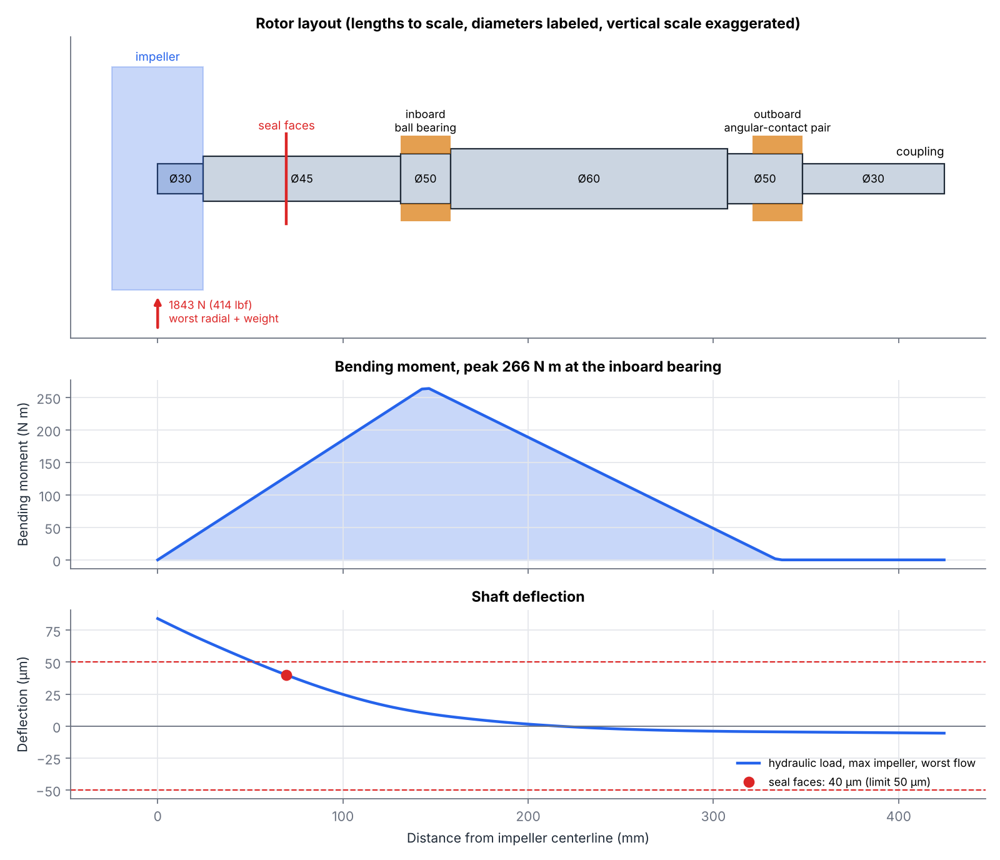
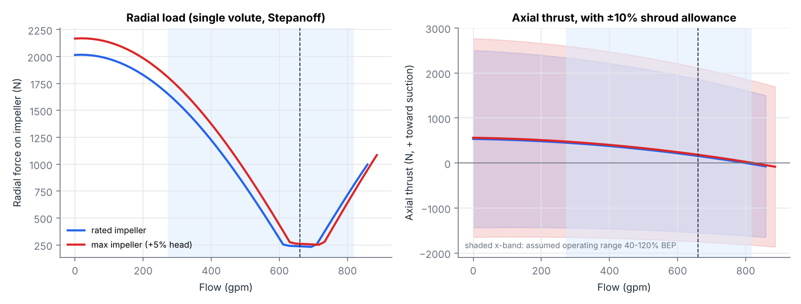
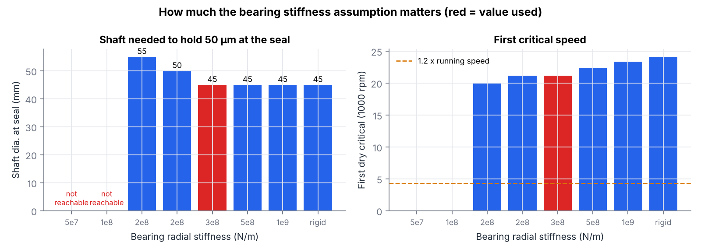
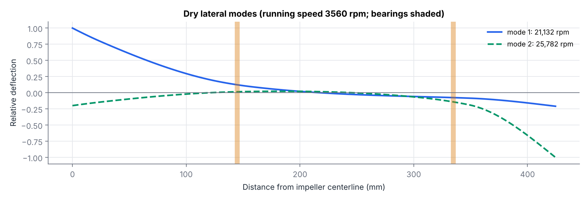
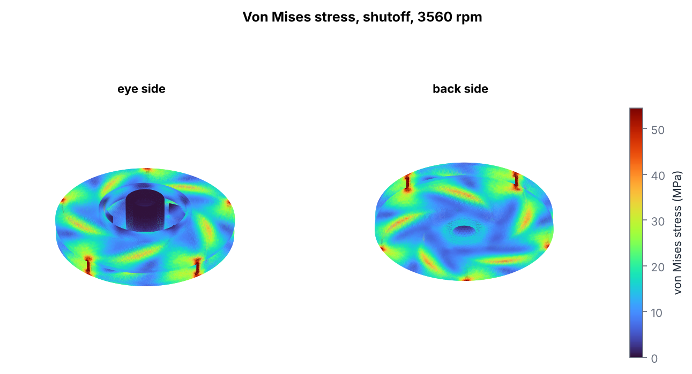
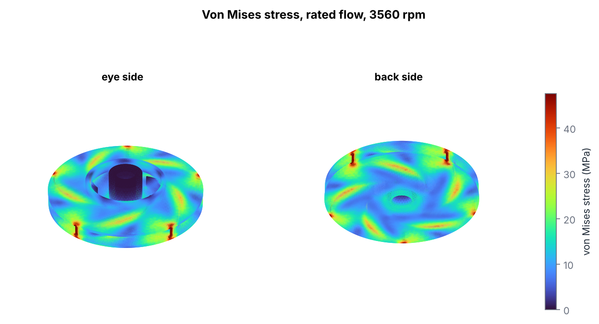

# Design study for an API 610 OH2 centrifugal pump

A design and analysis tool for a single-stage overhung process pump, the type API 610 calls
**OH2** (centerline-mounted, its own bearing housing, flexibly coupled). It covers the pump in
three parts:

1. **Hydraulics.** It sizes a complete impeller and volute for a duty point, predicts the full
   performance curve, sweeps the choices a pump engineer makes, and optimizes for efficiency under
   the screening checks a buyer would apply.
2. **Drive end.** From the impeller's radial and axial loads it sizes the shaft, bearings, key,
   coupling and motor, then checks seal-face deflection, fatigue and the first critical speed.
3. **Impeller structure.** A 3D finite-element model of the impeller under spin, passage pressure,
   side-gap pressure and blade loading.

**Study guide:** [`docs/STUDY_GUIDE.md`](docs/STUDY_GUIDE.md) explains the reasoning behind every
modeling choice, the problems found along the way, and a self-quiz.

**Interactive version:** `web/` is a phone-friendly page that runs the hydraulic model in the
browser, with sliders, live curves, an impeller drawing and a "find best design" button.


## Result in one paragraph

For an example duty of **660 gpm at 295 ft and 3560 rpm** (150 m³/h, 90 m; specific speed
Ns ≈ 1285, nq ≈ 25) with 32.8 ft (10 m) NPSH available, the baseline impeller built from standard
statistical correlations comes out at **8.69 in (220.8 mm), 6 blades, 81.8% efficiency, 60.2 hp**.
A constrained optimization over blade count, outlet angle, outlet width, eye diameter and inlet
incidence found a **5-blade, 28° design at 82.8% efficiency and 59.5 hp** that passes every
screening check. The gain is 1.0 point, about 4,200 kWh a year for a pump running 8,000 hours.
It is paid for in suction performance: the optimizer shrinks the eye until the NPSH margin sits
on its 1 m (3.3 ft) floor. The drive end for that impeller is a **75 hp motor** and a **4140 shaft
stepping 30 / 45 / 50 / 60 mm**, with **40 µm** of deflection at the seal faces against the API 610
limit of 50 µm. The first dry critical speed is **5.9× running speed**, and the lowest fatigue
safety factor is **2.4**. In 3D finite elements, the impeller's mesh-converged stresses peak at
**79 MPa** at shutoff, **7×** below the yield strength of CA6NM cast stainless.

## Part 1: hydraulics

| | Baseline | Optimized |
|---|---|---|
| Blades | 6 | 5 |
| Outlet blade angle β2 | 22.5° | 28.0° |
| Impeller diameter D2 | 220.8 mm (8.69 in) | 223.4 mm (8.79 in) |
| Outlet width b2 | 17.1 mm | 14.1 mm |
| Eye diameter / hub diameter | 111.2 / 48 mm | 103.2 / 48 mm |
| Inlet blade angle β1 / incidence | 26.7° / +3.0° | 33.6° / +5.9° |
| Efficiency at rated flow | **81.8%** | **82.8%** |
| Shaft power | 60.2 hp | 59.5 hp |
| NPSH required (3%, est.) | 29.1 ft | 29.5 ft |
| NPSH margin | 3.7 ft | 3.3 ft (at the 1 m floor) |
| Head rise to shutoff | 19.9% | 18.0% |
| Wear-ring leakage | 6.4% of flow | 6.0% of flow |
| Rated flow vs BEP | 100% | 100% |

### Method

Every design point is a complete pump, re-sized for the duty, so designs are compared fairly:

1. **Hub first.** The motor and shaft are sized from the duty (see Part 2), and the impeller hub is
   1.6× the shaft. The hub blocks part of the eye, so it has to be known before the eye is sized.
2. **Initial sizing** from statistical correlations against specific speed (Gülich,
   *Centrifugal Pumps*): the head coefficient for the outlet diameter, the outlet width ratio, and
   the eye diameter that minimizes NPSH required for the free area around the hub.
3. **Velocity triangles** at the eye and the outlet, including blade blockage, with slip from the
   **Wiesner** correlation. Euler's equation gives the ideal head.
4. **Losses** subtracted from the ideal head: inlet incidence, impeller channel friction (hydraulic
   diameter and channel length from the blade geometry), volute mismatch, volute friction and the
   discharge cone.
5. **Wear-ring leakage** through front and back rings (0.40 mm diametral clearance), driven by the
   static pressure the impeller builds minus the drop from fluid rotation in the side gap. It is
   solved iteratively, because the leakage changes the flow through the impeller, which changes the
   pressure.
6. **Power**: Euler power on the impeller flow, plus **disk friction** (Daily–Nece, both shrouds)
   and 1% for bearings and the mechanical seal.
7. **NPSH required** from the inlet-velocity form λc·cm1²/2g + λw·w1²/2g.
8. **The diameter is solved** (Brent's method) so the head at rated flow equals the target, which
   is what trimming an impeller does in practice. **The inlet blade angle is iterated** so the
   requested incidence holds at the real inlet flow angle, leakage and blockage included. **The
   volute throat is sized** so the rated flow lands on the best efficiency point.

### Calibration

The textbook loss coefficients are not trusted on their own. One scale factor on the friction
losses is set so the baseline's **hydraulic** efficiency at BEP equals the statistical value for
pumps of this size and specific speed (89.7%). The factor (2.50) is then **frozen** for every other
design, so differences between designs come from the physics, not from re-tuning. As an
independent check, the overall efficiency correlation, which was not used in calibration, predicts
82.0%. The model gives 81.8%.

### Screening checks

| Check | Limit | Why |
|---|---|---|
| NPSH margin | ≥ 1 m (3.3 ft) | Common purchaser requirement against cavitation |
| Rated flow vs BEP | 80–110% | API 610 rated-flow window |
| Head rise to shutoff | ≥ 10% | A commonly specified value, for stable parallel operation and control |
| Stable curve | head rises as flow drops, judged down to 10% flow (0.05% noise tolerance) | API 610 asks for a curve that rises continuously to shutoff |
| w2/w1 (de Haller) | ≥ 0.70 | Limits deceleration of the relative flow in the impeller |
| Outlet width | ≥ 8 mm | Castable without core trouble |
| Blade count | 5–9 | Usual practice at this specific speed |

### What the study shows

- **Efficiency against suction performance is the main trade.** The best designs shrink the eye
  until NPSH required reaches the margin limit, and push inlet incidence to the top of the searched
  range (+6°), which lets a smaller eye keep its flow angle.
- **The hub matters.** Sizing the hub for the real 30 mm shaft (48 mm, up from a 31 mm placeholder)
  took away 14% of the eye area. NPSH margin on the baseline fell from 5.4 ft to 3.7 ft, the
  optimizer's gain shrank from 1.7 points to 1.0, and 7-blade designs no longer pass, because their
  blade blockage now pushes NPSH required over the limit.
- **A steeper outlet angle buys efficiency but costs curve stability**, and the model catches this
  the way real pumps show it. Head rise to shutoff falls from 42% at 14° to 5.5% at 36°. The curve
  goes wrong before it gets there: from 24° up (at the correlation's outlet width) the head curve
  develops a **hump** between 10% and 40% of rated flow, so head falls as flow drops. A pump with a
  humped curve can hunt between two operating points, which is why API 610 asks for a curve that
  rises continuously to shutoff. The optimized 28° design passes only because its outlet is
  narrower (0.82×), which steepens the curve again.
- **The optimum is a flat ridge.** The best 5-blade (28°, 0.82× width) and 6-blade (35°, 0.61×)
  designs land within 0.2 points of each other. The deciding factors would be ones this model does
  not score: castability of a 10 mm outlet, pressure pulsation, and curve shape.
- **Blade count matters little for efficiency** (81.8% at 5 and 6 blades, 81.3% at 9, each
  re-sized to the duty), but more blades block the eye and raise NPSH required.

## Part 2: drive end



| Item | Result | Requirement |
|---|---|---|
| Motor | **75 hp**, 2-pole, 150 N·m | ≥ 115% of 59.5 hp rated (API 610, 22–55 kW band); covers 71.6 hp at end of curve with max impeller |
| Shaft, AISI 4140 Q&T | **Ø30** impeller fit / **Ø45** seal / **Ø50** bearings / **Ø60** span / **Ø30** coupling | sized below |
| Seal-face deflection | **40 µm** | ≤ 50 µm (API 610), max impeller, worst flow in 40–120% BEP |
| First dry critical | **21,100 rpm, 5.9× running** | ≥ 1.2× (stiff-shaft design rule) |
| Shaft fatigue (DE-Goodman, 99% reliability) | **2.4** at the inboard bearing shoulder, 2.7 at the impeller keyseat | ≥ 2 (own target) |
| Impeller key | **8 × 7 mm** (DIN 6885), 43 mm long, safety factor 4.8 | ≥ 2 |
| Inboard bearing | deep-groove ball, 50 mm bore, **C ≥ 48.9 kN** | L10 ≥ 25,000 h rated, ≥ 16,000 h at max load (API 610) |
| Outboard bearings | paired 40° angular-contact, back to back, 50 mm bore, **C ≥ 48.5 kN for the pair** (30.0 kN each) | same |
| Coupling | rated ≥ **225 N·m** | 1.5 × motor torque (assumed service factor) |

### Method

- **Radial load** on the impeller from **Stepanoff's** single-volute correlation,
  F = K·ρgH·D2·B2 with K = 0.36·|1 − (Q/Q_BEP)²|, floored at 0.05 because a real volute never
  balances completely. Worst case: the **maximum impeller** (API 610 requires room for a 5% head
  increase) anywhere from an assumed 40% to 120% of BEP. That gives **1.81 kN**. At rated flow it is
  only 0.24 kN, which is why pumps live longest near BEP.
- **Axial thrust** for a closed impeller with equal front and back wear rings and balance holes.
  The shroud pressures cancel, leaving inlet momentum, suction pressure on the shaft section, the
  pressure drop across the balance holes, and a **±10% allowance on one shroud's force** for unequal
  fluid rotation in the two side gaps. The allowance dominates: nominal thrust at rated is 0.16 kN,
  but the bearing is sized for **2.6 kN**. That is honest, because real thrust on a balanced
  impeller is hard to predict, which is why OH2 pumps carry a duplex thrust bearing.
- **Shaft** as Euler–Bernoulli beam finite elements (4 mm elements, stepped diameters), with the
  bearings as springs. The seal section starts 10 mm above the impeller fit and steps up 5 mm at a
  time until both the seal-face deflection (with 10% margin) and the bearing-shoulder fatigue pass.
  The impeller-fit diameter comes from motor torque at 40 MPa design shear.
- **Critical speeds** from the same beam model with consistent mass matrices plus the impeller
  (mass and diametral inertia estimated from its geometry) and the coupling hub as lumped masses.
  These are *dry* criticals: the wear rings add Lomakin stiffness in service, which only raises them.
- **Fatigue** by **DE-Goodman** (Shigley): fully reversed bending from the stationary load on a
  rotating shaft, steady torque from the motor, Marin factors for a machined surface, size and 99%
  reliability. Stress concentrations: end-milled keyseat Kt 2.14 / Kts 3.0, sharp bearing shoulder
  2.7 / 2.2, 3 mm fillet 1.7 / 1.5, with notch sensitivity taken as 1 (conservative).
- **Bearings**: the required basic dynamic load rating C for L10 life, with SKF's equivalent-load
  factors for 40° pairs (P = Fr + 0.55 Fa up to Fa/Fr = 1.14, then 0.57 Fr + 0.93 Fa). The tool gives
  the C to look for; pick the bearing from a catalog with that bore.



### The assumption that matters most: bearing stiffness



The bearings are springs in this model, and their stiffness turns out to set the shaft size.
At 1×10⁸ N/m or less, the bearings alone let the seal faces move more than 50 µm, and no shaft
diameter fixes it. At 1.5×10⁸ the seal section needs Ø55; at 2×10⁸, Ø50. From 3×10⁸ up, the seal
section stops at Ø45, because there the bearing-shoulder **fatigue** check governs, not deflection.
The design uses **3×10⁸ N/m**, typical of preloaded ball bearings this size in a stiff housing. On a
real pump that number should come from the bearing maker and the housing design.



## Part 3: impeller stress (3D finite elements)



| Item | Rated flow | Shutoff |
|---|---|---|
| Static pressure rise across the impeller | 672 kPa | 764 kPa |
| Pressure difference across each blade | 421 kPa | 397 kPa |
| Von Mises, blades, 99th percentile | 69 MPa | **79 MPa** |
| Von Mises, shrouds, 99th percentile | 40 MPa | 45 MPa |
| Von Mises, hub, 99th percentile | 17 MPa | 17 MPa |
| Peak at the sharp blade-to-rim corners | 273 MPa | 313 MPa (a mesh artifact, see below) |
| Wear-ring lip growth (radial) | 2.2 µm | 2.3 µm, against 200 µm radial clearance |

Material: ASTM A743 CA6NM, minimum yield 550 MPa. The impeller is a long way from yield. Its
safety factor on the converged stresses is about 7, and even the singular corner peak stays
below yield.

### Model

- **Geometry** built in gmsh/OpenCASCADE straight from the hydraulic design: a flat back shroud, a
  conical front shroud following the meridional passage, the front wear-ring lip, the hub around
  the 30 mm shaft, and 5 blades with the same camber lines as the plan view, fused into one
  solid. Everything is built oversize at the outlet and then cut to D2 in a single step, the way a
  lathe finishes the OD, so the shrouds and blade tips share one clean outer face.
- **Mass check**: the solid weighs **3.57 kg**, against 3.49 kg from the drive end's hand estimate.
- **Loads** at 3560 rpm, as gauge pressures relative to suction:
  1. centrifugal body force, ρω²r;
  2. passage pressure on every wetted surface, from the rothalpy balance
     p − p_s = ρ/2[(u² − u1²) − (w² − w1²)], scaled to land on the hydraulic model's outlet pressure;
  3. side-gap pressure on the outside of both shrouds, with the fluid rotating at half speed (the
     same model the leakage and thrust use);
  4. blade loading: each blade's circulation, 2π r2 cu2 / z, spread over its length, gives a mean
     pressure difference ρ·w·Δw, added to the pressure side and taken off the suction side.
- **Bore clamped** to the shaft. Quadratic tetrahedra (P2) in scikit-fem, 146k elements and 783k
  unknowns, solved by conjugate gradients with an algebraic-multigrid preconditioner that is
  given the six rigid-body modes. Each case takes about 6 minutes.

### Which numbers to trust

The same rated case on a coarser mesh (41k elements) moves the 99th-percentile stresses by only
4–5% (blades 66 → 69 MPa), so those are **converged**. The peaks at the blade-to-rim corners keep
climbing as the mesh refines (213 → 273 MPa), the signature of a **stress singularity** at a corner
that has no fillet. A real casting has fillets there, and the peak would be finite and lower. The
honest reading is that the converged values set the margin and the corners need fillets, not that
the material sees 273 MPa.

### Verification

The same solver, applied to a rotating disc with a clamped bore and a free rim, reproduces the
closed-form plane-stress hoop stress within **0.3%** at every radius checked (2% tolerance in the
automated test, on a coarser mesh).

### Not covered

Fatigue from pressure pulsations as the blades pass the volute tongue (it needs the pulsation
amplitude, which a 1D model does not give), casting fillets, and the impeller's own vibration modes.

## Verification (`tests/`, 20 checks)

| Check | What it proves |
|---|---|
| Lossless head equals Euler head | The loss bookkeeping adds up exactly |
| Wiesner slip against a hand calculation | The slip formula is coded right |
| Rated head hit, rated flow within 80–110% of BEP | The sizing loop converges to what was asked |
| Overall efficiency within 2 points of the correlation | Independent check of the calibration |
| **Affinity laws** at 80% speed: Q ∝ n, H ∝ n² within 3% | The physics scale correctly |
| Head falls steadily with flow above 10% of rated | Stable curve |
| Shaft power exceeds hydraulic power at every flow | Energy is conserved |
| Requested incidence lands at rated flow | The inlet-angle loop converges |
| **JavaScript port matches Python** within 0.2% | The phone page shows the same results |
| Overhung tip deflection = F a²(a+L)/3EI | The beam finite elements are right |
| Point mass on an overhang: ω → √(k/m) | The eigenvalue solution is right |
| Bearing reactions balance forces and moments | Statics |
| DE-Goodman and L10 life against hand calculations | The fatigue and bearing formulas are coded right |
| Radial load is smallest near BEP | The load model behaves physically |
| The full design passes every check | End to end |
| **Rotating disc, 3D FEA vs closed form** | The 3D solver and boundary conditions are right |

## Figures (`outputs/`)

| | |
|---|---|
|  | **Baseline curves** with the preferred operating region (70–120% of BEP) and NPSH available. |
|  | **Where the head goes** across the flow range, and the **power budget** at rated flow. |
|  | **Velocity triangles** at rated flow. |
|  | **One variable at a time**, every point re-sized to the same duty. |
|  | **Blade count × outlet angle** map of efficiency and head rise. |
|  | **1,000 random designs**: efficiency against NPSH required. |
|  | **Plan view** of both impellers, blade camber lines laid out from the blade-angle distribution. |
|  | **Impeller stress at rated flow**, 3D finite elements. |

## Limits, stated plainly

- The hydraulics are a **1D meanline estimate, not CFD**. Expect 10–20% error on absolute head
  and efficiency against a real pump. Differences between designs are more reliable than the
  absolute values.
- **Low flow is not modeled**: no suction or discharge recirculation, so the last ~10% of flow
  before shutoff is not judged.
- **Fewer blades than 5** look attractive to the 1D losses because the model cannot see the
  flow-guidance and pressure-pulsation penalties. That is why blade count is bounded by practice.
  A blade-loading loss (Coppage's diffusion factor) was tried and switched off: it put a 3% hump
  near shutoff on a conventional 6-blade design. The diffusion factor is still reported.
- **NPSH required** is an estimate from a two-coefficient correlation. Real NPSH3 comes from test.
- **The drive-end layout** (overhang, span, seal position) is a plausible arrangement for this
  size, not a drawing. Radial and axial loads are correlations with real scatter, and the thrust
  allowance is a judgment.
- **The impeller mass** (3.5 kg, confirmed by the 3D solid) assumes 5 mm shrouds and no fillets. A
  real casting is likely heavier, which would lower the critical speed. With a 5.9× margin, that
  does not change the conclusion.
- **The 3D impeller** has constant-thickness, cylindrical blades, a conical front shroud and no
  fillets. Its corner peaks are singular (see Part 3); the 99th-percentile values are the ones to use.
- The API 610 items are **screening checks, not compliance**. The standard is paid; check the
  exact clause values in your edition.
- **The duty point is an example**, not a real pump.

## Run it

```bash
pip install -r requirements.txt
python -m pytest -q          # 20 checks, about 15 seconds
python run_study.py          # hydraulic study, about 10 minutes, writes outputs/
python run_drive_end.py      # drive end for the optimized impeller, about 1 minute
python run_impeller_fea.py   # 3D impeller stress, about 16 minutes (needs gmsh; on Linux, libGLU)
```

Open `web/index.html` in a browser for the interactive version.

## Next steps

- **Impeller fatigue**: blade-pass pressure pulsation, with fillets modeled at the blade roots.
- **Validation** against a published pump test curve.
- **Drive end in the browser**: port the shaft and bearing checks to the phone page.

## Layout

```
pump/meanline.py      1D performance model
pump/sizing.py        sizing for a duty point, BEP matching, summary metrics
pump/calibrate.py     one-factor calibration against the statistics
pump/correlations.py  Gülich efficiency correlations
pump/shaftrule.py     motor selection and shaft size from the duty, so the hub is known first
pump/drive_end.py     loads, shaft beam model, critical speeds, fatigue, bearings, key, motor
pump/impeller_fea.py  3D impeller geometry (gmsh), P2 elasticity solve (scikit-fem + pyamg)
run_study.py          hydraulic sweeps, design map, random sample, optimizer, figures
run_drive_end.py      drive-end design and figures for the optimized impeller
run_impeller_fea.py   impeller stress at rated flow and shutoff, plus a mesh-convergence run
tests/                verification checks, including the JS port
web/                  interactive page (index.html + pump.js)
outputs/              figures, results.json, drive_end.json, fea.json
```
