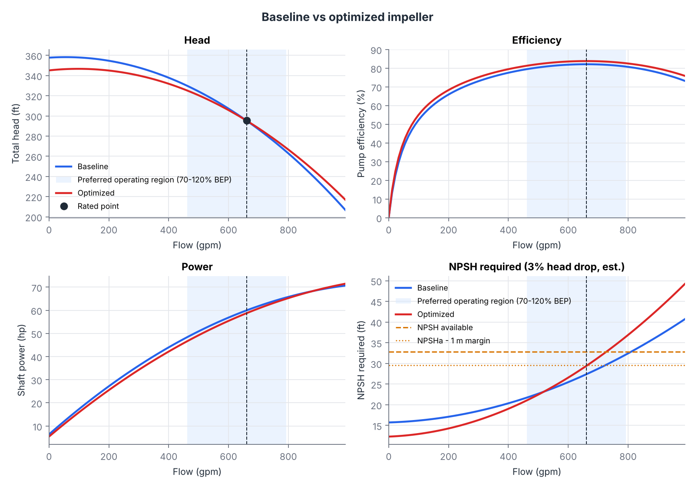
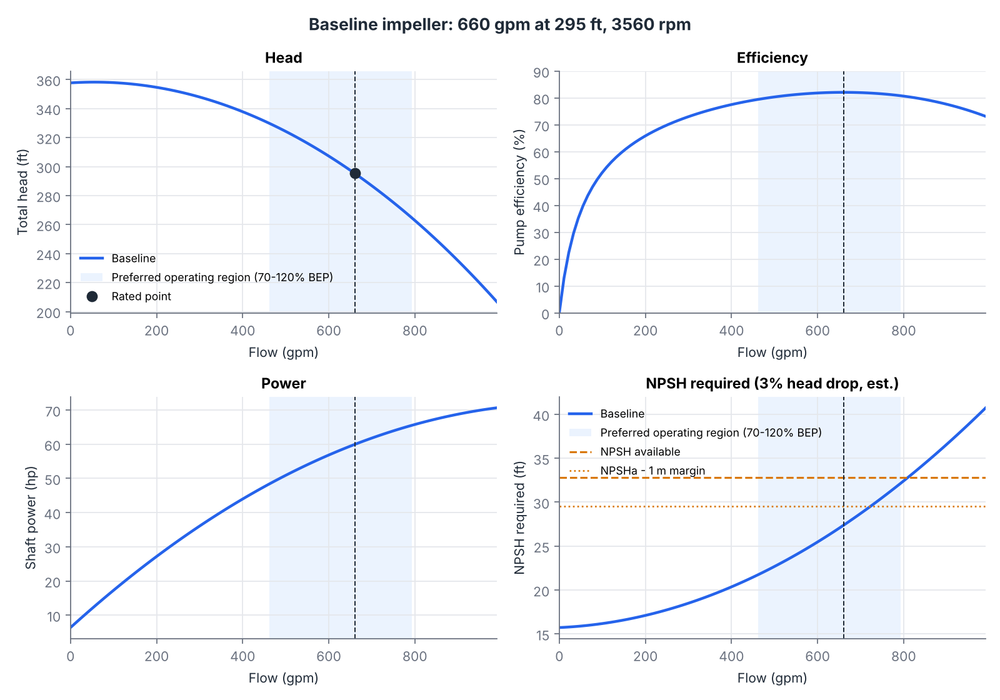
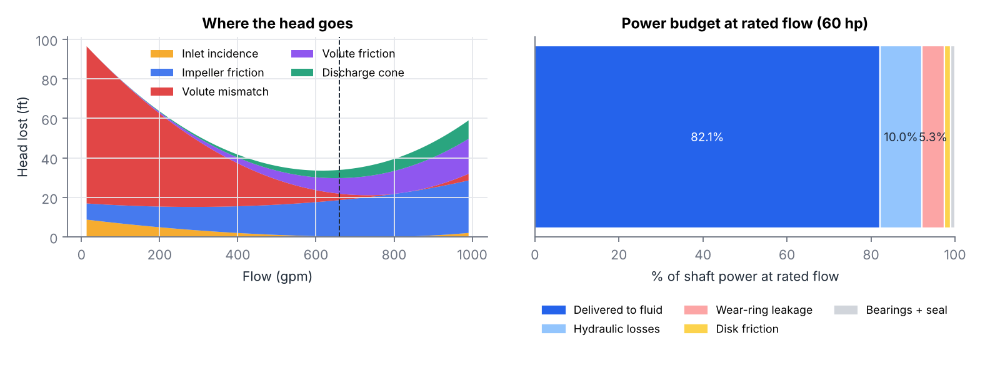
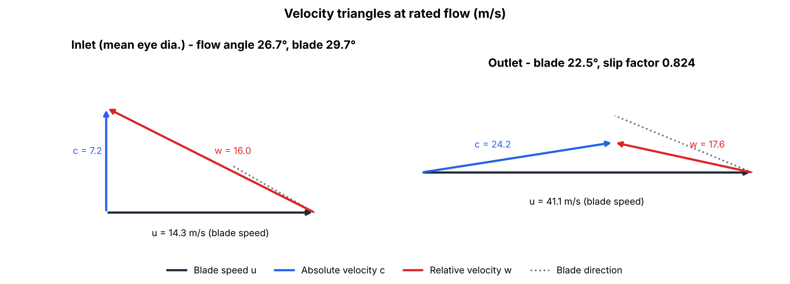
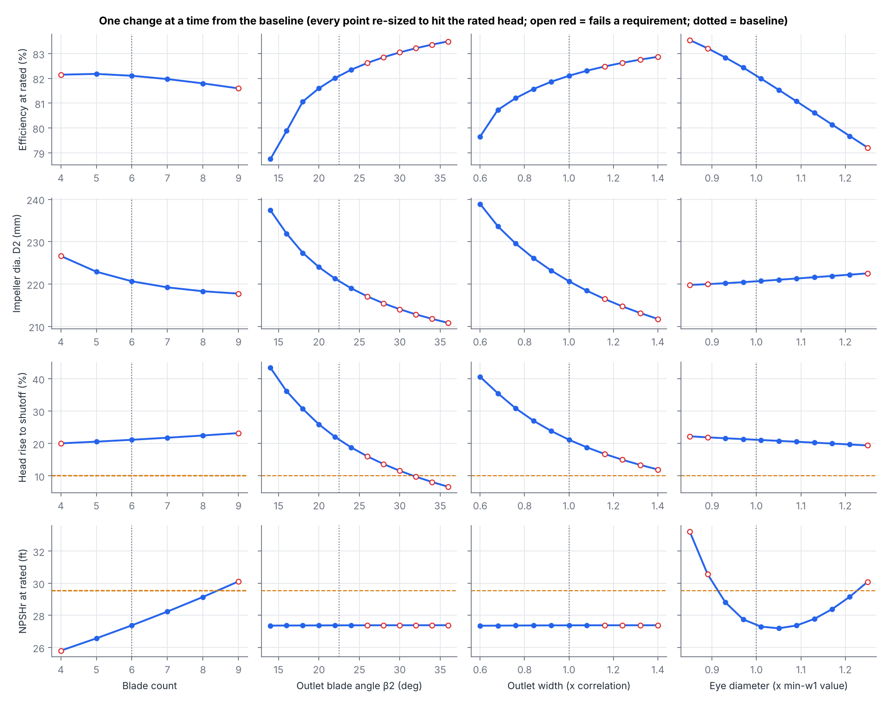
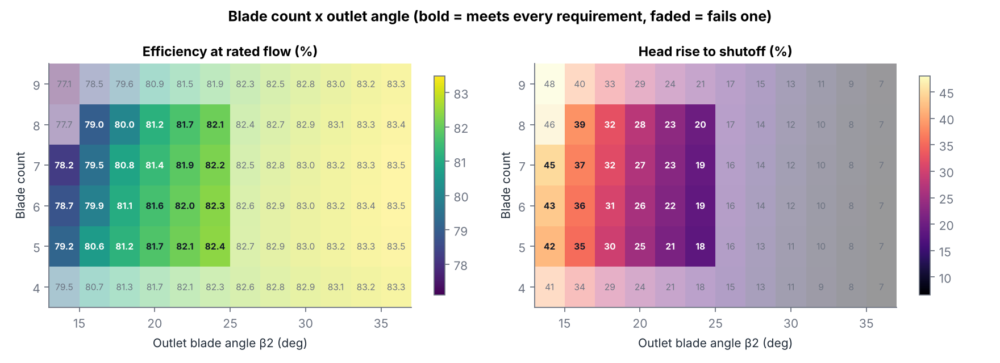
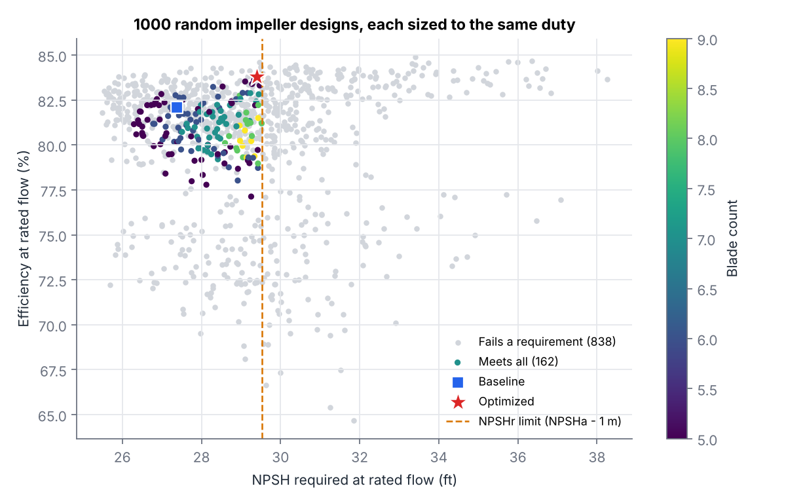
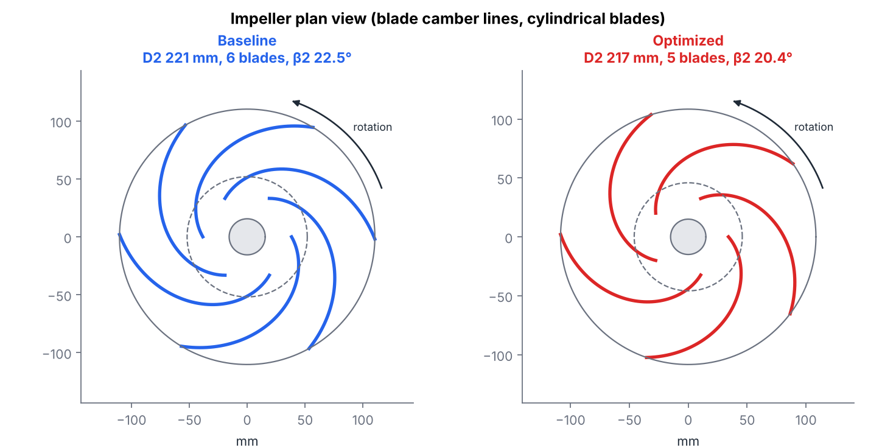

# Impeller design study for an API 610 OH2 centrifugal pump

A 1D design and analysis tool for the impeller of a single-stage overhung process pump, the
type API 610 calls **OH2** (centerline-mounted, its own bearing housing, flexibly coupled). It
sizes a complete impeller and volute for a duty point, predicts the full performance curve, sweeps
the design choices a pump engineer makes, and optimizes for efficiency under the screening checks
a buyer would apply.

**Interactive version:** the `web/` folder is a phone-friendly page that runs the same model in
the browser (sliders, live curves, an impeller drawing and a "find best design" button).



## Result in one paragraph

For an example duty of **660 gpm at 295 ft and 3560 rpm** (150 m³/h, 90 m; specific speed
Ns ≈ 1285, nq ≈ 25) with 32.8 ft (10 m) NPSH available, the baseline impeller built from standard
statistical correlations comes out at **8.69 in (220.7 mm), 6 blades, 82.1% efficiency, 60.0 hp**.
A constrained optimization over blade count, outlet angle, outlet width, eye diameter and inlet
incidence found a **5-blade, 20.4° design at 83.8% efficiency and 58.7 hp**, which passes every
screening check. That is 1.7 points of efficiency and 1.3 hp less shaft power at the same duty,
about 7,800 kWh a year for a pump running 8,000 hours (roughly $780 a year at $0.10/kWh). The
saving comes almost entirely from a smaller eye, which cuts wear-ring leakage and friction, and it
is paid for in suction performance: the NPSH margin drops from 5.4 ft to 3.4 ft, just above the
3.3 ft (1 m) minimum. That trade, efficiency against NPSH, is the central compromise in pump design, and the
optimizer runs straight into it.

| | Baseline | Optimized |
|---|---|---|
| Blades | 6 | 5 |
| Outlet blade angle β2 | 22.5° | 20.4° |
| Impeller diameter D2 | 220.7 mm (8.69 in) | 216.8 mm (8.54 in) |
| Outlet width b2 | 17.1 mm | 21.9 mm |
| Eye diameter | 103.8 mm | 91.8 mm |
| Inlet blade angle β1 / incidence | 29.7° / +3.0° | 40.4° / +6.0° (search limit) |
| Efficiency at rated flow | **82.1%** | **83.8%** |
| Shaft power | 60.0 hp | 58.7 hp |
| NPSH required (3%, est.) | 27.4 ft | 29.4 ft |
| NPSH margin | 5.4 ft | 3.4 ft (limit 3.3 ft) |
| Head rise to shutoff | 21.1% | 16.9% |
| Wear-ring leakage | 6.0% of flow | 5.5% of flow |
| Rated flow vs BEP | 100% | 100% |

## Method

Every design point is a complete pump, re-sized for the duty, so designs are compared fairly:

1. **Initial sizing** from statistical correlations against specific speed (Gülich,
   *Centrifugal Pumps*): head coefficient for the outlet diameter, outlet width ratio, and an eye
   diameter that minimizes the relative velocity at the inlet.
2. **Velocity triangles** at the eye and outlet, including blade blockage, with slip from the
   **Wiesner** correlation. Euler's equation gives the ideal head.
3. **Losses** subtracted from the ideal head: inlet incidence (shock), impeller channel friction
   (hydraulic diameter and channel length from the blade geometry), volute mismatch, volute
   friction and the discharge cone.
4. **Wear-ring leakage** through front and back rings (0.40 mm diametral clearance), driven by
   the static pressure the impeller builds minus the pressure drop from fluid rotation in the side
   gap. It is solved iteratively, because the leakage changes the flow through the impeller, which
   changes the pressure.
5. **Power**: Euler power on the impeller flow, plus **disk friction** (Daily–Nece, both shrouds)
   and a 1% allowance for bearings and the mechanical seal.
6. **NPSH required** from the classic inlet-velocity form λc·cm1²/2g + λw·w1²/2g.
7. **The diameter is solved** (Brent's method) so the head at rated flow is exactly the target,
   which is what trimming an impeller does in practice. **The inlet blade angle is iterated** so
   the requested incidence holds at the real inlet flow angle, leakage and blockage included.
   **The volute throat is sized** so the rated flow lands at the best efficiency point.

### Calibration

The textbook loss coefficients are not trusted on their own. One scale factor on the friction
losses is set so the baseline's **hydraulic** efficiency at BEP equals the statistical value for
pumps of this size and specific speed (89.7%). The factor (2.82) is then **frozen** for every other
design, so differences between designs come from the physics, not from re-tuning.

The independent check: the model's **overall** efficiency at BEP comes out at **82.1%**, against
**82.0%** from the separate overall-efficiency correlation. Only the hydraulic one was used to
calibrate.

## Verification (`tests/`)

| Check | What it proves |
|---|---|
| Lossless head equals Euler head | The loss bookkeeping adds up exactly |
| Wiesner slip against a hand calculation | The slip formula is coded right |
| Rated head hit, rated flow within 80–110% of BEP | The sizing loop converges to what was asked |
| Overall efficiency within 2 points of the correlation | Independent check of the calibration |
| **Affinity laws** at 80% speed: Q ∝ n, H ∝ n² within 3% | The physics scale correctly |
| Head falls steadily with flow above 10% of rated | Stable curve |
| Shaft power exceeds hydraulic power at every flow | Energy is conserved |
| Requested incidence lands at rated flow | The inlet-angle loop converges |
| **JavaScript port matches Python** within 0.2% | The phone page shows the same results |

## Screening checks used by the optimizer

| Check | Limit | Why |
|---|---|---|
| NPSH margin | ≥ 1 m (3.3 ft) | Common purchaser requirement against cavitation |
| Rated flow vs BEP | 80–110% | API 610 rated-flow window |
| Head rise to shutoff | ≥ 10% | A commonly specified value, for stable parallel operation and control |
| Stable curve | head rises as flow drops, judged down to 10% flow (0.05% noise tolerance) | API 610 asks for a curve that rises continuously to shutoff |
| w2/w1 (de Haller) | ≥ 0.70 | Limits deceleration of the relative flow in the impeller |
| Outlet width | ≥ 8 mm | Castable without core trouble |
| Blade count | 5–9 | Usual practice at this specific speed |

These are screening checks, not API 610 compliance. The standard is paid; check the exact clause
values in your edition.

## Figures (`outputs/`)

| | |
|---|---|
|  | **Baseline curves** with the preferred operating region (70–120% of BEP) and NPSH available. |
|  | **Where the head goes** across the flow range, and the **power budget** at rated flow: 82% to the fluid, 10% hydraulic losses, 5% leakage. |
|  | **Velocity triangles** at rated flow. |
|  | **One variable at a time**, every point re-sized to the same duty. |
|  | **Blade count × outlet angle** map of efficiency and head rise. |
|  | **1,000 random designs**: efficiency against NPSH required. |
|  | **Plan view** of both impellers, blade camber lines laid out from the blade-angle distribution. |

## What the study shows

- **Efficiency against suction performance is the main trade.** The best designs shrink the eye
  until NPSH required reaches the margin limit, and push inlet incidence to the top of the searched
  range (+6°), which lets a smaller eye keep its flow angle. A designer with more NPSH available would take a
  better impeller; one with less pays in efficiency.
- **The optimum is a flat ridge, not a peak.** A narrow outlet with a steep angle (about 0.65–0.7× width,
  34–36°) and a wide outlet with a shallower angle (about 1.3×, 20°) make the same head and land
  within 0.3 points of each other (83.6% and 83.8%). The browser optimizer finds the first family and the Python one
  the second. Both are real answers. The deciding factors would be things this model does not
  score: curve shape (the shallow angle gives a steeper, more stable curve), castability and
  pressure pulsation.
- **Blade count matters less than expected for efficiency** (82.2% at 5 blades, 81.6% at 9, each
  re-sized to the duty). More blades reduce slip, so the diameter shrinks, but they block the eye
  and add friction. At 9 blades the blockage pushes NPSH required past the limit.
- **A steeper outlet angle buys efficiency but costs curve stability**, and the model catches
  this the way real pumps show it. Head rise to shutoff falls from 43% at 14° to 7% at 36°,
  crossing the 10% requirement near 32°. But the curve goes wrong earlier than that: from 26° up
  (at the correlation's outlet width) the head curve develops a **hump** between 10% and 40%
  of rated flow, so head falls as flow drops. A pump with a humped curve can hunt between two
  operating points, which is why API 610 asks for a curve that rises continuously to shutoff. In the
  blade-count × angle map, that hump is what rules out the steep-angle designs, not head rise. The
  steep-angle designs only pass with a much narrower outlet.

## Limits, stated plainly

- This is a **1D meanline estimate, not CFD**. Expect 10–20% error on absolute head and
  efficiency against a real pump. Differences between designs are more reliable than the
  absolute values.
- **Low flow is not modeled**: no suction or discharge recirculation, so the last ~10% of flow
  before shutoff is not judged.
- **Fewer blades than 5** look attractive to the 1D losses because the model cannot see the
  flow-guidance and pressure-pulsation penalties. That is why blade count is bounded by practice.
  A blade-loading loss (Coppage's diffusion factor) was tried and switched off: it put a 3% hump
  near shutoff on a conventional 6-blade design. The diffusion factor is still reported.
- **NPSH required is an estimate** from a two-coefficient correlation. Real NPSH3 comes from test.
- **The duty point is an example**, not a real pump.

## Run it

```bash
pip install -r requirements.txt
python -m pytest -q          # 10 checks, about 2 seconds
python run_study.py          # full study, about 10 minutes, writes outputs/
```

Open `web/index.html` in a browser for the interactive version.

## Next steps

- **Drive end**: shaft stress and fatigue, deflection at the seal faces, first critical speed,
  bearing L10 life, coupling and key sizing, motor selection.
- **Impeller structure**: FEA of the blades and shrouds under centrifugal and pressure loads.
- **Validation** against a published pump test curve.

## Layout

```
pump/meanline.py      the 1D performance model
pump/sizing.py        sizing for a duty point, BEP matching, summary metrics
pump/calibrate.py     one-factor calibration against the statistics
pump/correlations.py  Gülich efficiency correlations
run_study.py          sweeps, design map, random sample, optimizer, figures
tests/                verification checks, including the JS port
web/                  interactive page (index.html + pump.js)
outputs/              figures and results.json
```
